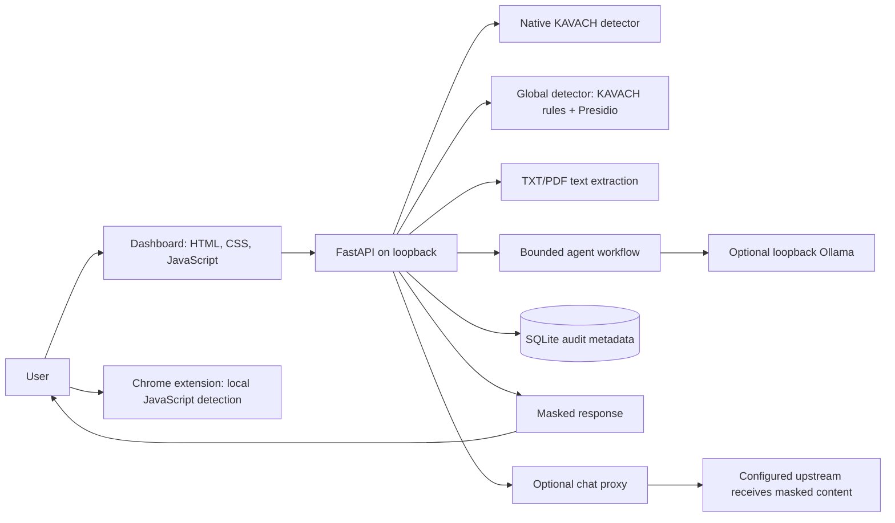

# KAVACH Lite

**A local-first prompt privacy prototype for detecting and masking selected sensitive data before it is shared with AI tools.** KAVACH combines a Python detection engine, a FastAPI service and dashboard, a Chrome extension, and a reproducible synthetic evaluation suite.

KAVACH is a development project. It does not guarantee that sensitive information will be detected or that every information leak will be prevented. The supported release setup is a single-user Windows application bound to loopback. It is not a hosted service or a production deployment.

## What it does

AI prompts can contain personal identifiers, credentials, and other sensitive information. KAVACH provides a user-controlled check and masking step before selected prompts are sent to AI sites. The project explores deterministic detection, per-type policy actions, and clear privacy boundaries across a browser extension and a local backend.

### Implemented features

- Detects supported formats including Aadhaar, PAN, phone numbers, payment-card numbers, email addresses, UPI IDs, GSTIN, IFSC, passwords, OTPs, API keys and passport numbers. Aadhaar Verhoeff, GSTIN check-character, card Luhn, and contextual rules help reduce selected false positives.
- Offers label and partial masking in the dashboard and backend. Partial masking preserves the last four digits for supported Aadhaar, card and phone findings; other types use labels.
- Provides a Chrome extension for ChatGPT, Claude and Gemini with per-type Allow, Warn, Mask and Block policy choices where exposed in Options. `AADHAAR_POSSIBLE` defaults to Warn and is not configurable in that page.
- Scans text and supported TXT/PDF documents through the FastAPI backend. PDF scanning is text extraction, not OCR.
- Includes a bounded, optional autonomous workflow. When enabled, a local Ollama model chooses from eligible workflow tools; Python performs the actions and deterministic scanning, masking and verification remain authoritative.
- Provides an OpenAI-compatible chat-completions proxy route that scans and masks message content before forwarding it to the configured upstream. Use of a remote upstream means that route is not fully local.
- Stores autonomous workflow audit metadata in SQLite, with 30-day retention by default.
- Includes synthetic evaluation datasets, regression tests and Python/JavaScript detector parity checks.

The extension and backend are separate detection paths. The extension does not run backend Presidio detection, and its policy actions are not equivalent to the backend's label/partial masking modes.

## Screenshots

Screenshots are not included in this repository yet. These are placeholders for future captures; no image files are linked or implied to exist.

| View | Screenshot |
|---|---|
| Protect dashboard | _Placeholder — screenshot not available_ |
| Findings and masked preview | _Placeholder — screenshot not available_ |
| Extension policy options | _Placeholder — screenshot not available_ |

## Architecture



### Technology

| Area | Implementation |
|---|---|
| Backend | Python, FastAPI, Uvicorn, Pydantic, HTTPX |
| Detection | Project rules and Microsoft Presidio with spaCy English model |
| Dashboard | HTML, CSS and vanilla JavaScript; no frontend build step |
| Browser extension | Chrome Manifest V3, JavaScript and `chrome.storage.sync` |
| Documents | `python-multipart` and `pypdf`; TXT and text-based PDF only |
| Audit | SQLite metadata storage and retention cleanup |
| Optional local model | Ollama; disabled by default and restricted to loopback |
| Verification | Python `unittest`, Node.js checks and deterministic synthetic fixtures |

Pinned backend dependencies are listed in [`requirements.txt`](requirements.txt). The extension does not require npm packages.

## Run locally on Windows

The supported launcher requires Windows PowerShell, Python, and a local `.env` file. Node.js 18 or later is needed to run the extension checks. Ollama is optional.

1. Open PowerShell in the repository root and create the virtual environment:

   ```powershell
   python -m venv .venv
   .\.venv\Scripts\python.exe -m pip install -r requirements.txt
   ```

2. Create a private `.env` containing `KAVACH_API_TOKEN`, `KAVACH_DB_PATH`, and `KAVACH_ALLOWED_HOSTS`. You can copy `.env.example`, replace its placeholder with a randomly generated token of at least 40 characters, and keep the file local. The launcher also requires the allowed hosts to include `127.0.0.1` and `localhost`. **Never commit `.env` or paste its token into a command, screenshot, or log.**

   The launcher reads unquoted `KEY=value` lines. The generated database path can be `data/kavach.db`; KAVACH initializes the SQLite schema on startup.

3. Start KAVACH from the project root:

   ```powershell
   .\tools\start_kavach.ps1
   ```

   To use a different port, for example:

   ```powershell
   .\tools\start_kavach.ps1 -Port 8001
   ```

   The launcher checks local health, copies the configured token to the clipboard without displaying it, and opens the dashboard. Paste that token when prompted. The default address is `http://127.0.0.1:8000`.

4. Stop only the KAVACH process started by the launcher:

   ```powershell
   .\tools\stop_kavach.ps1
   ```

The `Start KAVACH.bat` and `Stop KAVACH.bat` files wrap these scripts. The server binds to loopback. `GET /api/health` is public for local readiness; protected API routes require the `X-KAVACH-Token` header.

### Optional local Ollama agent

Install Ollama separately and obtain the default model (`llama3.2:3b`). Add these lines to the local `.env` and restart KAVACH:

```text
KAVACH_AGENT_ENABLED=1
KAVACH_AGENT_TIMEOUT=30
```

The agent remains disabled by default. KAVACH accepts only loopback Ollama URLs. The workflow sends bounded findings/workflow metadata to the model, not the original or masked prompt. Model output cannot override deterministic scan, masking or verification decisions.

### Load the Chrome extension

In Chrome, open `chrome://extensions`, enable Developer mode, choose **Load unpacked**, and select the repository's `extension/` directory. The extension package and automated checks passed, but installation on the release-review machine was blocked because Developer mode was administrator-managed. Installed-extension Allow/Warn/Mask/Block behavior therefore remains unverified in Chrome. Test with synthetic text only.

## Tests

Run the complete Windows preflight from the repository root:

```powershell
powershell.exe -NoProfile -ExecutionPolicy Bypass -File .\tools\run_preflight.ps1
```

It runs the Python unit suite and compilation, extension policy/privacy and detector-parity checks, JavaScript syntax checks, manifest validation, and a Git whitespace check. The Python suite can also be run directly:

```powershell
.\.venv\Scripts\python.exe -m unittest discover -v
```

Useful focused extension checks:

```powershell
node --check .\static\app.js
node --check .\extension\content.js
node --check .\extension\detector.js
node --check .\extension\options.js
node .\extension\tests\policy_and_privacy.js
node .\extension\tests\parity.js
```

### Recorded release verification

The release preflight recorded **105 passing Python tests**, **1,557/1,557 native detector parity cases**, passing extension policy/privacy and package checks, passing JavaScript syntax checks, and passing manifest and Git whitespace checks. These checks verify selected behavior; they are not a security certification, installed-browser acceptance, or accuracy guarantee.

## Evaluation

The latest documented holdout is a fixed, project-authored synthetic set of 60 prompts: 20 positive, 20 tricky positive and 20 negative, covering 20 entity types. It is not a human-created or representative sample of real user data. The evaluator matches an entity only when its type is exact and the predicted span overlaps at least half of the labelled span. Negative false-positive rate is measured per negative prompt. Latency is measured after a shared synthetic warm-up; reported p50/p95 figures exclude registry initialization.

| System | Micro precision | Micro recall | Micro F1 | Negative-prompt FPR | p50 / p95 latency (ms) |
|---|---:|---:|---:|---:|---:|
| KAVACH native | 0.95 | 0.45 | 0.61 | 5% (1/20) | 0.036 / 0.058 |
| KAVACH Global | 0.86 | 0.95 | 0.90 | 20% (4/20) | 8.275 / 17.360 |
| Regex only | 0.74 | 0.35 | 0.47 | 15% (3/20) | 0.032 / 0.043 |
| Presidio | 0.80 | 0.20 | 0.32 | 5% (1/20) | 9.850 / 13.305 |
| Presidio custom | 0.86 | 0.30 | 0.44 | 5% (1/20) | 12.222 / 16.960 |
| Presidio normalized | 0.86 | 0.30 | 0.44 | 5% (1/20) | 9.244 / 13.897 |

On this set, the global detector had higher recall and a higher negative false-positive rate than the native detector. The native detector missed global-only entity classes. With only 20 negative prompts, each false positive changes FPR by five percentage points. These results describe this dataset and environment only; they do not establish real-world accuracy or generalization. See [`docs/independent_synthetic_holdout.md`](docs/independent_synthetic_holdout.md) and [`results/independent_synthetic_holdout_steady_state/report.md`](results/independent_synthetic_holdout_steady_state/report.md) for methodology and detail.

The 1,557-case parity result compares shared native Python and JavaScript detector fixtures. It is not parity with Presidio or proof of browser-site integration behavior.

## Security and privacy

- **Extension path:** prompt scanning runs in the browser. The extension requests Chrome storage and its source has no direct network calls. Per-type settings use `chrome.storage.sync`. If a user submits a prompt, the destination AI service receives what remains after that policy action; Allow can pass the original prompt.
- **Dashboard/backend path:** the supported launcher binds to `127.0.0.1`; API operations use a local token, and write requests receive same-origin checks and security headers. Health is intentionally public.
- **Chat proxy:** a separate backend route; it forwards masked message content to its configured upstream. Do not treat this route as fully local or production-ready.
- **Agent path:** Ollama is loopback-only. The planner receives bounded workflow/finding metadata rather than prompt text or detected source values.
- **Audit path:** SQLite stores workflow metadata, not prompt content or detected values. Retention is 30 days by default and can be configured. SQLite files are not encrypted by default.
- **Uploads:** only TXT/PDF, up to 5 MiB per file and 20 pages per PDF. Scanned PDFs are not OCR processed; uploaded files and extracted text are not persisted by the scan route.

These controls reduce specific risks; they do not guarantee detection or complete privacy. Use synthetic or appropriately consented and anonymized data for evaluation and demonstrations.

## Limitations and future work

- Detection is rule-based and can miss unsupported, obfuscated, novel or contextual formats. Presidio is configured for English; multilingual detection quality is not established.
- Extension site selectors can break as target websites change. Installed-extension policy behavior was not verified on the review machine due to administrator-managed Developer mode.
- Rate limits are in-memory and apply only to selected routes; they do not coordinate multiple workers and omit `/api/scan-global` and `/api/agentic/scan`.
- SQLite is not encrypted by default; there is no versioned migration framework or documented, tested backup/restore process.
- The optional agent has variable model latency and is not independently evaluated for semantic review quality.
- Docker files are experimental and unsupported. No hosted deployment, multi-user identity system, continuous monitoring, OCR, or production readiness is provided.

Potential follow-up work includes broader and independently prepared evaluation, additional language coverage, shared rate limiting, a reviewed persistence/backup design, and a separately assessed hosting model. See [`docs/deployment_readiness.md`](docs/deployment_readiness.md); it describes prerequisites for possible future hosting, not an available deployment.

## Project scope and contributions

KAVACH Lite is a local-first software engineering project exploring prompt-time detection and masking across a browser extension and a local API. It is not enterprise DLP, a compliance product, a hosted service, or a guarantee against data leakage.

Issues and pull requests are welcome. Include a concise reproduction case and the checks you ran. Use synthetic fixtures only; do not submit real personal information, customer data, API keys, tokens, database files, or logs. Keep changes within the documented local-development scope and include focused regression coverage for behavior changes. No `LICENSE` file is currently included; clarify licensing before reusing or redistributing the project.

## Further documentation

- [Windows setup and project guide](README_FIRST.md)
- [Reproducible demo runbook](docs/demo_runbook.md)
- [Security validation notes](docs/security_validation.md)
- [Synthetic holdout methodology and results](docs/independent_synthetic_holdout.md)
- [Future deployment prerequisites](docs/deployment_readiness.md)
- [Chrome extension details](extension/README.md)
